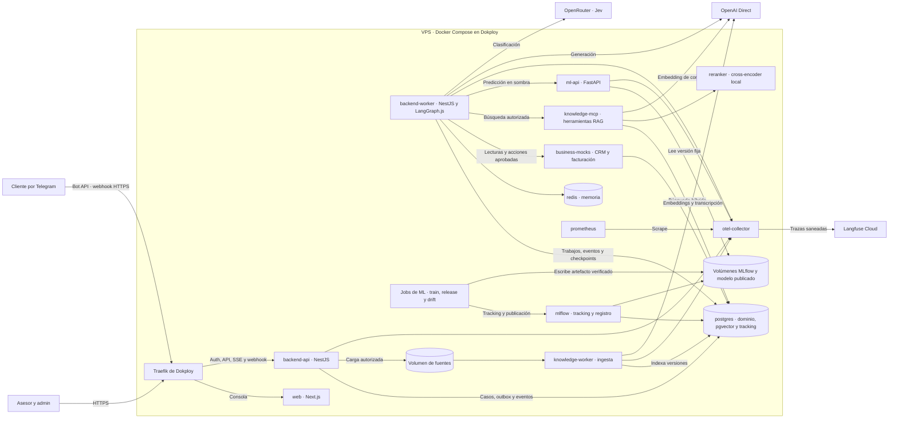
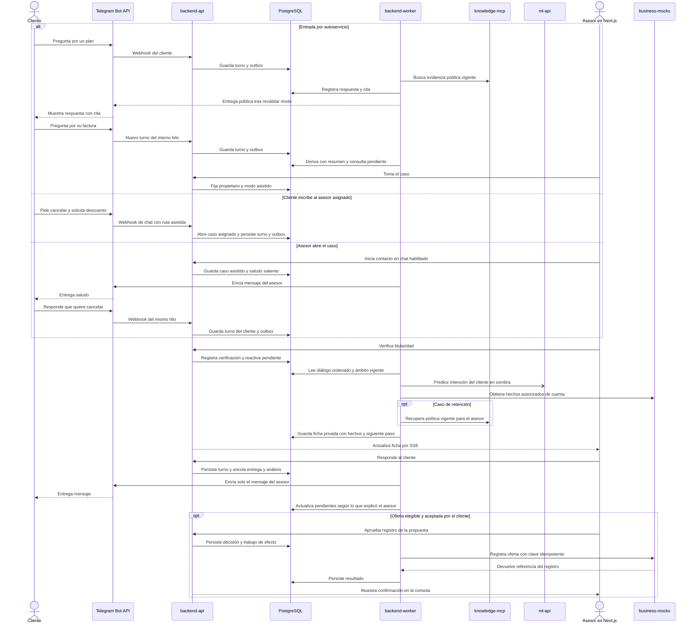
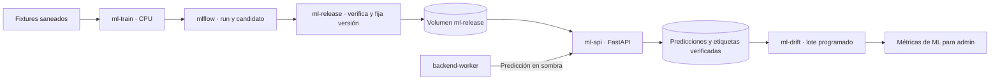
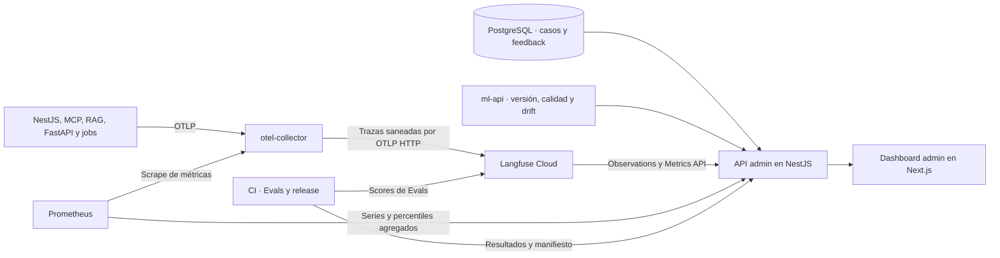

# Arquitectura de software y despliegue de Claro Copiloto

El diseño prevé desplegar la demo con **Docker Compose sobre la VPS con Dokploy**. Traefik es el único punto de entrada público de la aplicación. **Next.js** sirve la consola y **NestJS** recibe sesiones, API, SSE y webhooks de Telegram. El agente vive en el mismo proyecto NestJS y se ejecuta en un worker separado. Conocimiento, modelos clásicos y telemetría tienen procesos propios. **PostgreSQL** conserva el estado durable y **Redis** la memoria de agente.

[Guía de arranque](01-arranque.md) · [DDD](03-dominio.md) · [Contratos v1](04-contratos.md) · [Backend y autenticación](plataforma/diseno.md)

## Vista de despliegue

Los frontends del asesor y admin son rutas de la misma aplicación Next.js. El navegador habla con NestJS a través de Traefik y recibe el resultado con la sesión de Better Auth. Los servicios internos se identifican por DNS de Compose. Traefik pertenece a la instalación de Dokploy y enruta los dos servicios públicos por dominio y ruta. [Compose en Dokploy](https://docs.dokploy.com/docs/core/docker-compose) · [Dominios de Compose](https://docs.dokploy.com/docs/core/docker-compose/domains)

## Inventario de contenedores

Los puertos de la tabla son **internos previstos**. Traefik termina TLS y publica únicamente la consola, los endpoints de API autorizados y el webhook. Las imágenes de aplicación se construyen en CI y se despliegan por digest.

| Servicio | Imagen y modo | Responsabilidad, dependencia y verificación |
| --- | --- | --- |
| `web` | Imagen Next.js de producción · continuo · `3000` | Consola de atención, citas, aprobaciones y admin. Consume `/api` en el mismo origen y conecta SSE. Smoke de render, autenticación y lectura de una bandeja. |
| `backend-api` | Imagen NestJS ESM · continuo · `3000` | API y webhook. Better Auth, roles, vinculación de titular, casos, decisiones y carga de fuentes. Escribe dominio y outbox en una transacción y emite SSE desde los eventos del run. Readiness con esquema vigente y conexión PostgreSQL. |
| `backend-worker` | **Misma imagen NestJS** · continuo · sin HTTP público | Consume jobs de atención, entrega de Telegram, decisiones y reanudaciones. Ejecuta LangGraph.js y Deep Agents. Usa puertos de negocio, MCP, ML, OpenAI, Jev y Redis. Health por heartbeat, procesamiento de outbox y edad de trabajo. |
| `knowledge-worker` | **Misma base NestJS**, variante de imagen con utilidades de extracción/OCR · continuo · sin HTTP público | Detecta cambios registrados o archivos añadidos a la carpeta de origen, extrae, anonimiza, transcribe, fragmenta, genera embeddings y publica índices. Tiene concurrencia acotada para trabajo de CPU. Reporta progreso y frescura. |
| `knowledge-mcp` | **Misma imagen NestJS** · continuo · `3030` privado | MCP Streamable HTTP en `/mcp`. Expone búsqueda pública y para asesor. Valida ámbito, fecha y visibilidad, consulta pgvector y texto completo y llama al reranker. Pruebas de contrato, filtros y respuesta sin reranker. |
| `reranker` | Imagen Node CPU con ONNX Runtime · continuo · `3040` privado | Sirve el cross-encoder multilingüe fijado por digest. Recibe pares consulta/pasaje y devuelve scores. Medir paridad con el modelo original y p95 en la VPS. Ante expiración, MCP usa el RRF ya filtrado y registra degradación. |
| `business-mocks` | Una imagen NestJS de mocks · continuo · `8080` privado | Un proceso con dos bases URL para CRM y facturación. Implementa los OpenAPI y carga los JSON sintéticos. Persiste escrituras aprobadas en PostgreSQL. Pruebas de contrato y efecto idempotente. |
| `postgres` | Imagen PostgreSQL con pgvector · continuo · `5432` privado | Datos de plataforma, auth, documentos, checkpoints, mocks y base lógica de MLflow. Volumen persistente y restauración probada. |
| `redis` | Imagen Redis · continuo · `6379` privado | Memoria de sesión y preferencias autorizadas. TTL, namespaces, ACL y persistencia AOF para recuperar el perfil. Health por conexión autenticada. |
| `ml-api` | Imagen Python/FastAPI · continuo · `8000` privado | Sirve intención TF-IDF + regresión logística en sombra, recoge correcciones y expone métricas agregadas. Carga un artefacto fijo de solo lectura validado al iniciar. |
| `mlflow` | Imagen MLflow OSS con driver PostgreSQL · continuo · `5000` privado | Tracking, registro y proxy de artefactos. UI por acceso privado autenticado. Readiness contra metadata y directorio de artefactos. |
| `otel-collector` | Distribución con receptores y exportadores requeridos · continuo · OTLP privado | Recibe trazas y métricas instrumentadas. Exporta trazas autorizadas a Langfuse y expone métricas a Prometheus. Health y métricas internas del colector. |
| `prometheus` | Imagen Prometheus · continuo · `9090` privado | Scrape del exportador del Collector, series técnicas, reglas de calidad de servicio y retención acotada. La API consulta agregados para el dashboard. |

Fuera del arranque continuo quedan los **jobs `db-migrate`, `seed-demo`, `ml-train`, `ml-release` y `ml-drift`**. Los dos primeros preparan datos y esquemas. `ml-train` y `ml-release` se ejecutan bajo demanda. `ml-drift` se programa con la operación de Dokploy y procesa lotes con recursos propios. Reservar las Evals al runner de CI contra el candidato local. Dokploy se usa para el corte de demo. [Jobs programados en Dokploy](https://docs.dokploy.com/docs/core/schedule-jobs) · [MCP Streamable HTTP en Node](https://ts.sdk.modelcontextprotocol.io/server) · [ONNX Runtime en Node.js](https://onnxruntime.ai/docs/get-started/with-javascript/node.html)

La imagen de `reranker` fija un artefacto ONNX del `cross-encoder/mmarco-mMiniLMv2-L12-H384-v1` y su tokenizador. Preparar la exportación durante la fase de empaquetado y validar equivalencia de ranking antes de usarla como evidencia de rendimiento. Configurar inicialmente un plazo de 350 ms y conservar la ruta RRF ante caída o saturación. [Modelo de referencia](https://huggingface.co/cross-encoder/mmarco-mMiniLMv2-L12-H384-v1) · [Cross-encoders con ONNX](https://sbert.net/docs/cross_encoder/usage/efficiency.html)

## Arquitectura interna del software

| Paquete o módulo | Responsabilidad |
| --- | --- |
| `apps/web` | Vistas del asesor y admin, cliente Better Auth y adaptador SSE. Carga datos por API mediante DTOs autorizados. |
| `apps/backend` | Arranque HTTP, worker, entrada MCP y módulos de Atención, Identidad, Canales, Aprobación, Retención, Administración y Telemetría. Casos de uso comprobados en API y worker. TypeORM para almacenamiento de dominio. |
| `packages/agent` | Grafo TypeScript con estados y rutas, especialistas de Deep Agents, prompts y selección de perfiles OpenAI. Adaptadores para Jev, MCP y predicción. El agente propone y espera la decisión persistida de plataforma. |
| Conocimiento | Ingesta, repositorio de fragmentos y versiones, búsqueda híbrida, cliente de re-ranking y resolución de citas. El MCP llama los casos de uso de lectura. El worker de ingesta tiene permisos de escritura del índice. |
| `services/ml` | Pipeline de entrenamiento, MLflow, API FastAPI, predictor, etiquetas verificadas y job de drift. Control del modo sombra y versión efectiva. |
| `packages/contracts` | Puertos TypeScript, esquemas de eventos, DTOs y fixtures. OpenAPI en la frontera con FastAPI y con las integraciones CRM/facturación. |

Las entradas NestJS comparten módulos y sus contratos. API y worker intercambian trabajos y eventos persistidos, con concesión temporal, límites por tipo de trabajo e idempotencia. Una lectura de CRM o facturación se hace a través de un adaptador autorizado. Las escrituras son comandos de plataforma vinculados a una propuesta y una aprobación.

## Redes, rutas e identidades

| Frontera | Ruta o conexión | Control |
| --- | --- | --- |
| Navegador a Traefik | HTTPS para `/` a `web` y `/api` a `backend-api`. `/api/auth` queda en Better Auth. | Mismo origen, cookie segura y roles por caso. Los streams SSE llevan heartbeat y cursor para reconectar. |
| Telegram a API | `POST /api/v1/webhooks/telegram` | Secreto del webhook, tamaño acotado y deduplicación por bot y `update_id`. Responder al proveedor después de guardar el mensaje. |
| Red de aplicación | API, workers, MCP, reranker, mocks, ML y DB según dependencias. | Conexiones privadas a los nombres de Compose. Credenciales separadas y roles PostgreSQL por función. El ámbito del run se deriva de plataforma y se valida en MCP. |
| Red de observabilidad | Servicios instrumentados, Collector, Prometheus y adaptador de lectura de admin. | OTLP y scrape internos. Los dashboards salen por la API autorizada. |
| Salidas autorizadas | OpenAI desde worker y conocimiento, Jev desde el worker y CI, Telegram Bot API desde el worker, Langfuse desde Collector/API/CI según operación. | Credenciales por integración. Solo habilitar salida de red en los procesos que la requieren. Transferir datos saneados. |

Para CRM y facturación, usar bases URL internas como `http://business-mocks:8080/crm/v1` y `http://business-mocks:8080/billing/v1`. Mantener paths, esquemas y `operationId` de los contratos originales a partir de esas bases. El worker envía una clave interna de efecto para conciliación del mock. Ante timeout después de una escritura, consultar su resultado antes de reintentar. Un CRM productivo debe tener su contrato de idempotencia y reconciliación verificado. [CRM OpenAPI](05-insumos.md#políticas-y-contratos) · [Facturación OpenAPI](05-insumos.md#políticas-y-contratos)

El MCP habilitado en la demo es **conocimiento de solo lectura**. Las herramientas de negocio son puertos tipados y adaptadores HTTP de plataforma. Un MCP externo se integraría con servidor y herramientas previamente registrados, permisos mínimos y pruebas de esquema. El contrato de canal permite incorporar WhatsApp y telefonía en entregas posteriores. En este MVP el recorrido del cliente se demuestra por Telegram.

## Persistencia y responsabilidades

| Persistencia | Contenido y propietario | Recuperación prevista |
| --- | --- | --- |
| Volumen `postgres-data` y bases lógicas | En la base del MVP, esquemas `platform` para casos/outbox/config, `auth` para Better Auth, `knowledge` para documentos y vectores, `agent_cp` para PostgresSaver y esquemas de mocks. Bases lógicas separadas para tracking de MLflow y señales operativas de ML cuando correspondan. | Backups lógicos por entorno y prueba de restauración. Migraciones versionadas de TypeORM y preparaciones de Better Auth, PostgresSaver, mocks y MLflow antes de levantar el release. |
| Volumen `redis-data` | Memoria de sesión saneada con TTL de 24 horas y perfil con preferencias autorizadas con TTL de 30 días. TTL iniciales de demo. | Persistencia AOF y revocación explícita por cambio de autorización. Si Redis falla, el agente recupera desde plataforma el contexto mínimo autorizado. Los checkpoints siguen en PostgreSQL. |
| Volumen `source-files` | Documentos originales y manifiesto, con hash, visibilidad y vigencia. La API escribe mediante carga autorizada y el worker de conocimiento lee. | Backup de fuentes y metadatos. Versiones indexadas pueden reconstruirse desde los archivos y el manifiesto. |
| Volumen `mlflow-artifacts` | Artefactos y métricas del entrenamiento servidos por MLflow. Los jobs usan el API de tracking. | Respaldo coordinado con la metadata del registro. Verificar que se recupere un run y su modelo con el mismo checksum. |
| Volumen `ml-release` | Bundle de modelo publicado por `ml-release` y montado de solo lectura en `ml-api`. | Conservar versiones por checksum y restaurar la referencia anterior. La inferencia puede continuar si el tracking se reinicia. |
| Volumen `prometheus-data` | Series técnicas con retención y tamaño definidos por el entorno. | Recuperación separada de las bases de dominio. La indisponibilidad temporal del historial de métricas no cambia el estado de atención. |

Crear roles y volúmenes por ambiente y externalizar respaldos. Las imágenes se construyen en varias etapas y corren con permisos mínimos. Separar readiness de liveness y probar recuperación tras reinicio, incluidos el worker, sus concesiones y las conexiones a los proveedores. [Redes de Compose](https://docs.docker.com/compose/how-tos/networking/) · [Orden de arranque de Compose](https://docs.docker.com/compose/how-tos/startup-order/) · [Backups en Dokploy](https://docs.dokploy.com/docs/core/databases/backups)

## Recorridos principales

### Atención y acción aprobada

Las tres entradas convergen en el mismo worker. Jev clasifica la intención y el grafo selecciona conocimiento público o recursos privados según modo, ámbito y propósito. Para C-1007, la regla de elegibilidad detiene la propuesta y la ficha explica el motivo. En todos los modos la plataforma decide el destino final y revalida el acceso al ejecutar. [Casos de demo y criterios](06-calidad-y-release.md#tres-casos-de-la-demo) · [Selección de modelos](agente/enrutamiento-y-reranking.md)

### Ingesta, recuperación y catálogo v2

1. El gestor carga un archivo y declara visibilidad, versión y vigencia. La API comprueba el rol y registra su hash. La carpeta de origen también admite detección automática. Un archivo detectado sin metadatos válidos queda pendiente de clasificación.
2. `knowledge-worker` normaliza PDFs, Word, tablas, EML y texto, aplica OCR si corresponde, transcribe WAV autorizados para ese proveedor y enmascara datos antes de indexar. Publica fragmentos con embeddings, versión, localizador, estado y fechas, conservando el índice anterior durante la preparación.
3. `knowledge-mcp` toma el ámbito del caso y la fecha de negocio. Filtra antes de recuperar. Fusiona búsqueda semántica y léxica mediante RRF, reordena candidatos con `reranker` y devuelve extractos y citas. El agente valida las referencias de la respuesta.
4. En demo, el reloj de negocio permite consultar a ambos lados de la entrada en vigor del catálogo v2. Medir por separado carga, indexación y activación. El dashboard muestra frescura y versión efectiva. [Procedimiento del reto](05-insumos.md#documentos-y-transcripciones)

### ML clásico y MLflow

Entrenamiento, registro, publicación y serving tienen ciclos independientes. `ml-train` lee fixtures, evalúa por grupos, registra en MLflow y propone una versión. `ml-release` verifica artefacto y firma, fija la versión y la publica para que FastAPI la cargue al iniciar. Si FastAPI falla, el worker registra timeout y sigue el flujo de atención. Las correcciones del asesor se vinculan por `prediction_id`. `ml-drift` calcula señales por canal y versión, con etiqueta visible cuando se usa un lote simulado. [Implementación de ML y MLflow](ml/diseno.md) · [Tracking de MLflow](https://mlflow.org/docs/latest/self-hosting/architecture/tracking-server/)

## Observabilidad, Evals y dashboard

- **Trazas.** Propagar `traceparent`, `run_id`, canal y revisión entre API, worker, MCP y ML. Separar spans de `decision.jev`, retrieval, re-ranking, OpenAI, herramientas, espera de aprobación, ejecución y entrega. `eval.jev` identifica el juez empleado en CI. Los servicios minimizan los datos al instrumentar. El Collector centraliza exportación y vuelve a filtrar atributos antes de enviar.
- **Langfuse.** La demo usa **Langfuse Cloud** para trazas, prompts versionados, uso, costo y Evals. El Collector exporta trazas por OTLP/HTTP al endpoint de Langfuse con autenticación y versión de ingesta requeridas. La API agrega trazas permitidas con Metrics y Observations API v2. Si el entorno exige self-hosting, desplegar el Compose oficial de Langfuse como proyecto separado, con sus procesos web y worker, PostgreSQL, ClickHouse, Redis o Valkey y almacenamiento de objetos. Reservar recursos independientes y mantener los mismos contratos de exportación y lectura. [Integración OTLP de Langfuse](https://langfuse.com/integrations/native/opentelemetry) · [API pública](https://langfuse.com/docs/api-and-data-platform/features/public-api) · [Langfuse self-hosted](https://langfuse.com/self-hosting/deployment/docker-compose)
- **Métricas técnicas.** Prometheus scrapea el endpoint privado de métricas exportado por el Collector. Mostrar p95 del primer contenido visible y respuesta final, tiempos de cola, error de herramientas, fallos de proveedores, heartbeat, latencia de RAG y frescura. No usar IDs de caso como etiquetas de métricas. [Configuración del Collector](https://opentelemetry.io/docs/collector/configuration/) · [Exportador Prometheus](https://github.com/open-telemetry/opentelemetry-collector-contrib/blob/main/exporter/prometheusexporter/README.md)
- **Logs y auditoría.** JSON a stdout con rotación y referencias opacas. Operación consulta logs desde Dokploy. PostgreSQL conserva auditoría de decisiones, resultados de acciones, propiedad y revisiones. Un fallo de telemetría se muestra como dato pendiente y queda separado de la disponibilidad del flujo de atención.
- **Dashboards.** La consola Next.js obtiene de NestJS datos de negocio y CSAT desde PostgreSQL, trazas y calidad desde Langfuse, salud y latencia desde Prometheus, calidad de modelo y drift desde `ml-api` y estado de release desde CI. Las claves quedan en servidor. [Contrato de observabilidad y roles](plataforma/observabilidad.md)
- **Gate de Evals.** CI ejecuta los 30 golden y los 19 casos complementarios, con aserciones deterministas para permisos, citas y efectos. Jev evalúa los pasos semánticos. Un release liga imágenes, prompts, corpus, reranker y modelo ML a un manifiesto único. La revisión de agente se activa desde administración tras el gate. [Evals con Jev](agente/jev-evals.md)

## Orden de despliegue y verificación

1. Crear volúmenes y redes por entorno. Preparar PostgreSQL, Redis y las credenciales. Configurar las dos rutas públicas en Traefik.
2. Ejecutar migraciones y seeds idempotentes. Cargar fixtures, corpus inicial, configuración de agente y una versión de ML en sombra.
3. Arrancar API, workers, MCP, reranker, mocks y ML. Activar Collector y Prometheus antes del smoke. La web recibe tráfico cuando la API y el flujo básico estén listos.
4. En staging, verificar login, Telegram, SSE tras reconexión, búsqueda por ámbito, firma de una aprobación, reanudación tras reiniciar el worker, idempotencia de escritura, catálogo v2, predictor caído y traza correlacionada.
5. Promover por digest el manifiesto validado. Ante un fallo posterior, restaurar el manifiesto previo y repetir smoke con migraciones compatibles. Verificar de forma periódica la restauración de PostgreSQL, fuentes y artefactos de MLflow.

El MVP parte de una réplica por proceso continuo y de límites independientes para jobs de CPU. La capacidad real de la VPS define los límites finales de memoria y concurrencia. La prueba de carga debe observar p95, profundidad del outbox y tareas demoradas antes de incrementar tráfico.
