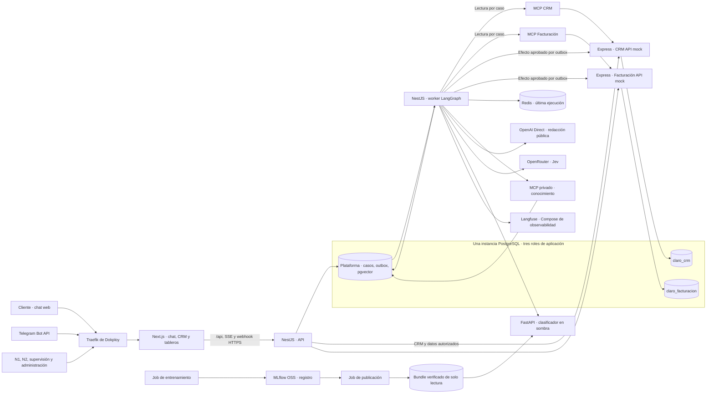
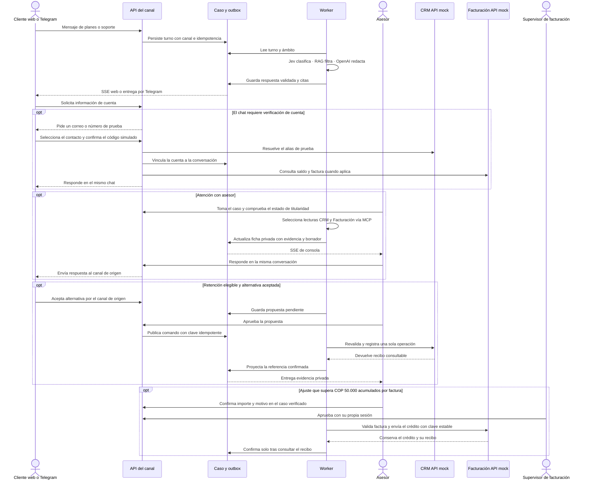

# Arquitectura del MVP en Dokploy

[Arquitectura y criterios del siguiente corte del MVP](evolucion-mvp/arquitectura-y-aceptacion.md) · [Agente, subgrafos y herramientas en Archify](evolucion-mvp/diagramas/arquitectura-agente.html)

Claro Copiloto comparte un expediente entre el chat web de cliente, Telegram y la consola de atención. El guion más reciente de la presentación define el alcance. La demo se empaqueta con Compose y el destino de despliegue es una VPS con Dokploy.

[Contratos](04-contratos.md) · [Operación](../infra/README.md) · [Criterios de corte](06-calidad-y-release.md)

## Servicios y persistencia

| Perfil | Procesos y almacenamiento |
| --- | --- |
| Base | Next.js sirve el chat en `/chat` y la consola en `/`. API, worker, migración y los MCPs privados de CRM y Facturación usan la misma imagen. PostgreSQL conserva casos, sesiones web, acciones, ejecuciones y outbox. Redis conserva el identificador de la última ejecución con TTL. Los mocks Express cargan 20 clientes y 60 facturas desde los insumos. El job de migración mantiene los volúmenes existentes y aprovisiona dos bases aisladas y sus roles. |
| knowledge | MCP privado de solo lectura. El corpus aprobado se prepara fuera del repositorio y se carga con el comando de ingesta. Filtros de audiencia y vigencia, búsqueda de texto y vectores de hashing en pgvector, fusión RRF y reordenamiento en el agente con términos de dominio, coincidencia ponderada y diversidad de fuentes. |
| ml y ml-jobs | MLflow OSS registra modelos con SQLite y persistencia en mlflow-data. La publicación verifica el modelo y su firma. FastAPI carga el bundle fijado desde ml-models en solo lectura y guarda señales en ml-state. Los fallos del predictor se auditan y la atención continúa. |
| observability | Prometheus obtiene métricas del backend. El agente exporta trazas OTLP saneadas a Langfuse. El Compose separado de Langfuse contiene web, worker, PostgreSQL, ClickHouse, Redis y almacenamiento compatible con S3. ClickHouse escucha en la red privada IPv4 y el worker espera el arranque verificado del servicio web. |

## Atención y acción aprobada

El navegador recibe un identificador opaco por cookie HttpOnly. El servidor proyecta el historial visible para esa sesión y mantiene la ficha privada en consola. Telegram vincula el chat desde el webhook autenticado. Ambos canales pueden verificar la cuenta del CRM mock mediante el flujo conversacional de OTP de demo. La titularidad permanece en el expediente al pasar a N1, N2 o supervisión según política. La plataforma revalida rol, revisión y titularidad antes de acceder a hechos privados y requiere aprobación para los efectos.

OpenAI recibe el tema saneado y pasajes públicos vigentes y con aprobación de procesamiento `provider_approved: true`. La aplicación valida referencias y cifras antes de persistir. Ante una falla puede volver al extracto citado o derivar. Las fuentes quedan ligadas a versión y vigencia. OCR automatizado y reranker ONNX son mejoras del diseño documental.

## Arquitectura objetivo en AWS

La propuesta de producción usa ALB y WAF delante de ECS Fargate, Aurora PostgreSQL con pgvector, outbox con relé a SQS FIFO y ElastiCache. S3 aloja documentos y habilita el procesamiento autorizado. Bedrock y SageMaker cubren generación y MLOps en esa arquitectura. WhatsApp y voz asistida con Connect se habilitarían por país tras validar cuotas, datos y operación. GCP se conserva como alternativa evaluada. El corte de demo usa Compose en Dokploy.
