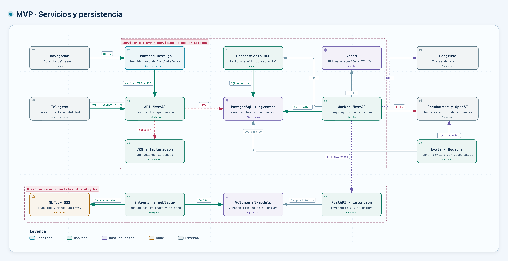
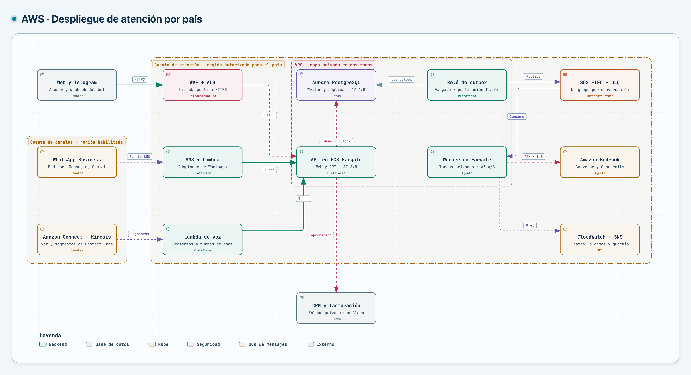

# Arquitectura de Claro Copiloto

El recorrido comienza con el MVP y termina con la propuesta de producción en AWS. Abre los PNG para ampliar los diagramas en GitHub. Para explorar los componentes y sus conexiones, descarga el HTML de la vista y ábrelo en el navegador. Cada diagrama incluye su fuente editable de Archify en JSON.

## Arquitectura del MVP

### Servicios y persistencia

El chat web y Telegram llegan a la plataforma. El diagrama muestra dónde se ejecutan Next.js, el agente y la inferencia con FastAPI, y qué guardan PostgreSQL con pgvector, Redis y MLflow.

[Ver PNG](png/arquitectura.png) · [Vista interactiva en HTML](arquitectura.html) · [Fuente de Archify](fuentes/arquitectura.json)

Las referencias al código en la vista interactiva apuntan a la revisión de desarrollo utilizada para preparar el diagrama. Se podrán consultar en GitHub cuando se publique esa revisión.

### Autoservicio y atención asistida

Quién responde al cliente en cada modo, cómo se transfiere el historial y qué información recibe el asesor en privado.

[Ver PNG](png/atencion.png) · [Vista interactiva en HTML](atencion.html) · [Fuente de Archify](fuentes/atencion.json)

### De la fuente a la respuesta con cita

Ingesta, fragmentación, vigencia documental, recuperación y reordenamiento de resultados antes de generar una respuesta.

[Ver PNG](png/conocimiento.png) · [Vista interactiva en HTML](conocimiento.html) · [Fuente de Archify](fuentes/conocimiento.json)

### Ciclo del clasificador de intención

Entrenamiento, registro en MLflow, inferencia en sombra y seguimiento del modelo.

[Ver PNG](png/mlops.png) · [Vista interactiva en HTML](mlops.html) · [Fuente de Archify](fuentes/mlops.json)

### Evaluación del agente con TDD y EDD

Pruebas de contratos y comparación del comportamiento del agente con casos de referencia, Jev y revisión humana.

[Ver PNG](png/evals.png) · [Vista interactiva en HTML](evals.html) · [Fuente de Archify](fuentes/evals.json)

### Despliegue y recuperación

Cómo se promueve una imagen identificada por su digest y cómo se recupera una versión anterior.

[Ver PNG](png/release.png) · [Vista interactiva en HTML](release.html) · [Fuente de Archify](fuentes/release.json)

## Arquitectura propuesta para producción en AWS

### Atención multicanal por país

Entrada de chat, mensajería y voz, enrutamiento hacia el asesor y observabilidad de la atención.

[Ver PNG](png/aws-atencion.png) · [Vista interactiva en HTML](aws-atencion.html) · [Fuente de Archify](fuentes/aws-atencion.json)

### Conocimiento y ciclo del modelo

Cómo se procesan y versionan las fuentes y cómo se entrena, registra y sirve el modelo en AWS.

[Ver PNG](png/aws-datos.png) · [Vista interactiva en HTML](aws-datos.html) · [Fuente de Archify](fuentes/aws-datos.json)
